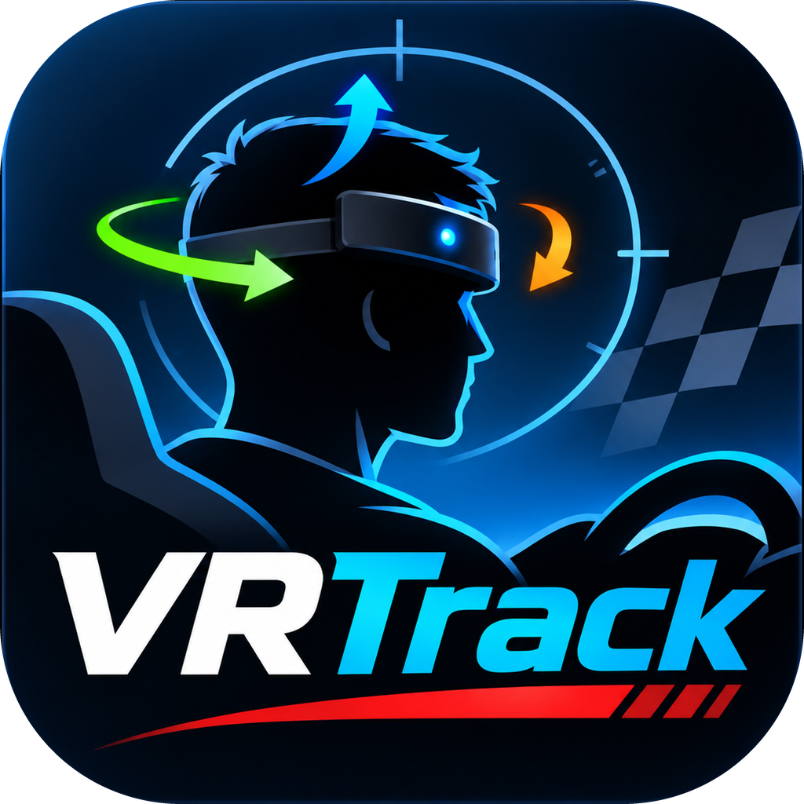

<p align="center">
  
</p>

# VRTrack

**Turn your Android phone into a head tracker for PC sim racing.** The phone's front camera tracks your head on the
phone itself; a small desktop app feeds the result to [OpenTrack](https://github.com/opentrack/opentrack), which makes
it work in games like Euro Truck Simulator 2 — no game mods, no dedicated hardware.

```
 Android phone                         Windows / Linux PC
┌──────────────────┐    UDP over     ┌───────────────┐        ┌───────────┐       ┌──────┐
│ camera → MediaPipe│  Wi-Fi or USB  │ VRTrack       │  UDP   │ OpenTrack │ FreeTrack │ Game │
│ face → head pose  │ ─────────────▶ │ tune + smooth │ ─────▶ │ (UDP in)  │ ────────▶ │      │
└──────────────────┘   tethering     └───────────────┘ :4242  └───────────┘       └──────┘
```

- **Private.** Video is processed on the phone and never stored or uploaded. Only pose numbers cross your local network.
  No accounts, ads, analytics or internet needed.
- **Works with the screen off.** Tracking runs in a foreground service; the notification shows status and has
  Recenter / Pause / Stop buttons, also on the lock screen.
- **Smooth.** The desktop app interpolates the phone's ~20 poses/s up to 120 updates/s for OpenTrack.
- **Tunable per game.** Sensitivity, dead zone, maximum, invert, response curve, smoothing and optional eye gaze, with
  saved profiles (General, Assetto Corsa, ACC, ETS2, ATS).
- **Optional eye tracking** (gaze + blink), independent of head tracking.

## Get it

Download from the [Releases](../../releases) page:

| | |
|---|---|
| **Windows** | `VRTrack-Setup-x.y.z.exe` — one installer that installs VRTrack **and OpenTrack**, opens the firewall for your phone and pre-configures OpenTrack. |
| **Android** | `VRTrack-x.y.z-android.apk` |
| **Linux** | `VRTrack-x.y.z-linux-x86_64.tar.gz` (install OpenTrack yourself) |

Then follow **[docs/setup.md](docs/setup.md)** — about five minutes.

## Documentation

| Guide | |
|---|---|
| [Setup](docs/setup.md) | Install, connect, calibrate, first run |
| [Games](docs/games.md) | ETS2 / ATS and other games |
| [Networking](docs/networking.md) | Wi-Fi, USB tethering, firewall |
| [Calibration & tuning](docs/tuning.md) | Getting the feel right |
| [Troubleshooting](docs/troubleshooting.md) | Every problem we have hit, and the fix |
| [Protocol](docs/protocol.md) | Wire format between phone and PC |
| [Development](docs/development.md) | Build, test, CI/CD, releases |

## Status

Tested end to end on a real Android phone with Euro Truck Simulator 2 on Windows 11 (USB tethering). Other games
should work through OpenTrack but are untested. Latency is roughly one phone frame plus the interpolation buffer
(about 50–100 ms) — fine for looking around a cab, not a TrackIR-class tracker.

## Repository layout

```
android/     Kotlin app: CameraX + MediaPipe Face Landmarker, Jetpack Compose UI, foreground service
pc/          Python desktop app: PySide6 UI, receiver, processing, OpenTrack output, tests
installer/   Windows installer (Inno Setup) that bundles OpenTrack
protocol/    Shared wire-format test vectors (checked on both sides)
tools/       Icon generation, model download, versioning
docs/        User and developer documentation
.github/     CI and release workflows
```

## License

[MIT](LICENSE). The Windows installer also installs OpenTrack (ISC) and bundles Qt for Python (LGPL-3.0);
see [installer/THIRD_PARTY_NOTICES.txt](installer/THIRD_PARTY_NOTICES.txt).
